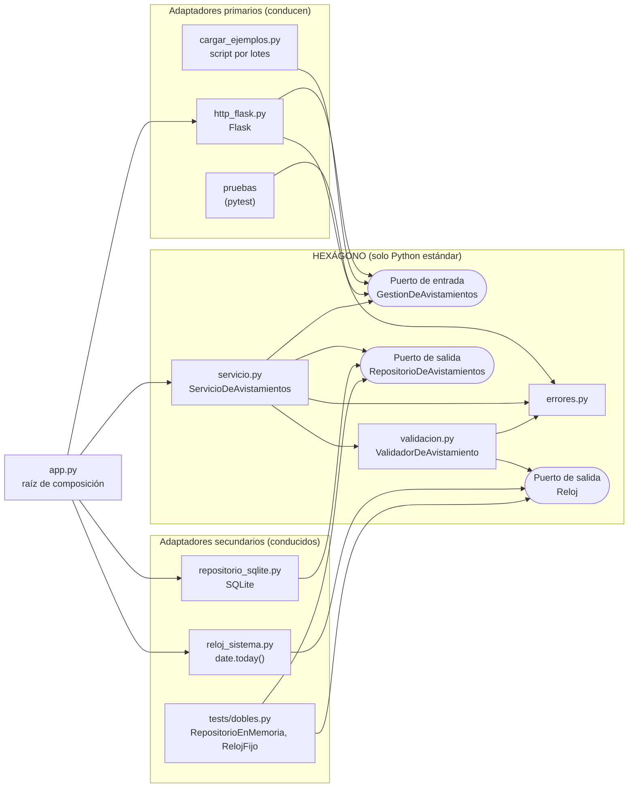

# Taller 5: Clean Architecture y arquitectura hexagonal

Ingeniería de Software 2 (ISW-2) · Miércoles 11 de noviembre de 2026
Estudiante: Sergio Andres Mahecha Rodriguez
API: avistamientos de aves (Python + Flask + SQLite)

- **Repositorio:** https://github.com/smahechar/API-REST-Avistamientos-Aves
- **Rama:** `taller5-hexagonal` (https://github.com/smahechar/API-REST-Avistamientos-Aves/tree/taller5-hexagonal)
- **Arquitectura elegida:** arquitectura hexagonal, o de puertos y adaptadores (Cockburn, 2005).

---

## Parte 1. Investigación

### 1. El problema de Cockburn, puertos, adaptadores y la simetría

El problema que Cockburn ve es que la lógica de negocio se mezcla con el código que habla con el exterior. Por el lado del usuario, las reglas terminan escritas dentro de la interfaz gráfica, y eso trae tres consecuencias: la aplicación no se puede probar de forma automática sin pasar por la pantalla, no se puede ejecutar por lotes y no la puede usar otro programa. Por el lado de la base de datos pasa lo mismo: si la lógica está amarrada a la base, el trabajo se detiene cada vez que la base no está disponible o se cambia. Cockburn agrega que meter una capa más no lo arregla, porque nada impide que la lógica se vuelva a colar en esa capa (Cockburn, 2005).

Su propuesta divide el sistema en un **adentro** (la aplicación) y un **afuera** (todo lo demás).

- Un **puerto** es una "conversación con propósito" entre la aplicación y el exterior, definida como una API. La idea viene de los puertos de hardware: cualquier dispositivo que cumpla el protocolo puede conectarse. Por ejemplo, "guardar y recuperar avistamientos" es un puerto (Cockburn, 2005).
- Un **adaptador** traduce entre ese puerto y una tecnología concreta. Para un mismo puerto puede haber varios adaptadores: una GUI, un arnés de pruebas automáticas, un script por lotes o una base de datos simulada en memoria (Cockburn, 2005).

La **simetría** consiste en que, para la aplicación, el usuario y la base de datos son lo mismo: actores externos detrás de un puerto. La diferencia que importa no es izquierda o derecha (interfaz o base de datos), sino adentro o afuera. Por eso los dos problemas tienen la misma causa y la misma solución. Lo único que cambia es quién empieza la conversación. Un **actor primario** (*driving*) conduce la aplicación, como el usuario o una prueba. Un **actor secundario** (*driven*) es conducido por ella, como la base de datos (Cockburn, 2005).

### 2. Los círculos de Clean Architecture y la regla de dependencia

Martin (2012) dibuja cuatro círculos concéntricos, de adentro hacia afuera:

1. **Entidades:** las reglas de negocio de la empresa, que valdrían aunque no existiera esta aplicación. Son lo que menos cambia cuando cambia algo externo.
2. **Casos de uso:** las reglas propias de esta aplicación. Coordinan el flujo de datos hacia las entidades y desde ellas para cumplir un objetivo, como "registrar un avistamiento".
3. **Adaptadores de interfaz:** convierten los datos entre el formato que les conviene a los casos de uso y el que les conviene al exterior. Aquí van los controladores, los presentadores y las vistas, y el SQL también queda en esta capa.
4. **Frameworks y drivers:** el anillo externo, con el framework web, la base de datos y otros detalles. Casi todo es código de pegamento.

La **regla de dependencia** dice que las dependencias del código fuente solo pueden apuntar **hacia adentro**. Prohíbe que un círculo interno sepa cualquier cosa de uno externo: no puede mencionar el nombre de una clase, función o variable declarada afuera, ni usar un formato de datos definido afuera, sobre todo si lo genera un framework. Martin aclara que no tienen que ser exactamente cuatro círculos, pero la regla se cumple siempre (Martin, 2012).

### 3. ¿Cómo guarda datos un caso de uso que no puede depender de la base?

Hay que separar dos cosas: hacia dónde va el **flujo de control** en ejecución (el caso de uso llama a la base, de adentro hacia afuera) y hacia dónde apunta la **dependencia del código fuente**. Martin resuelve la contradicción con el principio de inversión de dependencias, apoyado en el polimorfismo. El círculo interno declara una interfaz con lo que necesita, el adaptador externo la implementa, y en ejecución se le entrega al caso de uso la implementación concreta. Así el caso de uso llama a algo de afuera, pero en el código solo conoce la interfaz, que está adentro (Martin, 2012). Es el principio de inversión de dependencias de SOLID: los módulos de alto nivel no dependen de los de bajo nivel, ambos dependen de abstracciones (Martin, 2017). Palermo describe lo mismo: las interfaces de repositorio están en el centro y sus implementaciones en el borde, y se inyectan en tiempo de ejecución (Palermo, 2008).

**Ejemplo con esta API.** El caso de uso `ServicioDeAvistamientos.crear()` necesita guardar.

```python
# ADENTRO: avistamientos/hexagono/puertos.py
class RepositorioDeAvistamientos(ABC):
    @abstractmethod
    def crear(self, datos: dict) -> dict: ...

# ADENTRO: avistamientos/hexagono/servicio.py  (solo conoce la interfaz)
class ServicioDeAvistamientos(GestionDeAvistamientos):
    def __init__(self, repositorio: RepositorioDeAvistamientos, validador): ...
    def crear(self, datos):
        return self._repositorio.crear(self._validador.validar(datos))

# AFUERA: avistamientos/adaptadores/secundarios/repositorio_sqlite.py
class RepositorioSQLite(RepositorioDeAvistamientos):   # importa el puerto: la flecha apunta adentro
    def crear(self, datos): ...  # INSERT en SQLite

# RAÍZ DE COMPOSICIÓN: app.py  (el único que conoce a los dos)
ServicioDeAvistamientos(RepositorioSQLite(ruta), ValidadorDeAvistamiento(RelojDelSistema()))
```

En ejecución, el control va del servicio a SQLite. En el código, `repositorio_sqlite.py` importa `puertos.py` y `servicio.py` nunca importa `sqlite3`. Por eso las pruebas unitarias pueden pasarle al mismo servicio un `RepositorioEnMemoria`.

### 4. Hexagonal, cebolla y Clean Architecture: qué comparten y qué cambia

**Lo que tienen en común.** Las tres ponen las reglas de negocio en el centro y tratan la interfaz, la base de datos y los frameworks como detalles externos y reemplazables. Las tres exigen que las dependencias apunten hacia el centro: Cockburn lo dice como "lo de adentro no se filtra hacia afuera", Palermo como "todo el acoplamiento va hacia el centro" y Martin como la regla de dependencia. Las tres usan interfaces definidas adentro e implementadas afuera, y por eso permiten probar el núcleo sin interfaz ni base de datos (Cockburn, 2005; Palermo, 2008; Martin, 2012). Martin mismo presenta su propuesta como una síntesis de la hexagonal, la de cebolla y otras (Martin, 2012), y Palermo reconoce que la hexagonal parte de la misma premisa (Palermo, 2008).

**Lo que cambia.**

| Aspecto | Hexagonal (Cockburn, 2005) | Cebolla (Palermo, 2008) | Clean Architecture (Martin, 2012) |
|---|---|---|---|
| Vocabulario | puertos, adaptadores, actores primarios y secundarios | modelo de dominio, servicios, núcleo de la aplicación, infraestructura | entidades, casos de uso, adaptadores de interfaz, frameworks y drivers |
| Capas dentro del núcleo | ninguna prescrita: solo "la aplicación" | varias capas alrededor del modelo de dominio, en número variable | cuatro círculos de referencia (pueden ser más) |
| Énfasis | la frontera adentro/afuera y la simetría entre quien conduce y quien es conducido | el modelo de dominio como centro, con la base de datos como algo externo | una regla única que se aplica a cualquier número de capas, y cómo cruzar fronteras (puertos de entrada y salida, presentadores) |
| Forma | hexágono (el número de lados no importa) | anillos concéntricos | círculos concéntricos |

En resumen, lo que más cambia es el vocabulario y cuánto detallan el interior. La hexagonal solo dibuja la frontera exterior. La cebolla y la Clean agregan capas dentro del núcleo, y la Clean es la más explícita sobre qué va en cada una y cómo pasan los datos de una a otra.

### 5. ¿Se justifica aplicarle Clean Architecture (o hexagonal) a esta API?

**Mi posición: sí, en su versión mínima (la hexagonal). No en la versión de cuatro círculos completos.**

- **Beneficio concreto: probar sin infraestructura y cambiar adaptadores sin tocar la regla.** La regla de negocio (especie de 3 a 50 caracteres, fecha real y no posterior a hoy) es lo que más se prueba en esta API: 57 de las 94 pruebas del taller anterior son unitarias y corren en milisegundos con un reloj fijo y un repositorio en memoria. Eso funciona porque el validador y el servicio no conocen Flask ni SQLite. Es justo lo que Cockburn plantea como objetivo: que la aplicación pueda ser conducida igual por usuarios y por pruebas automáticas, y desarrollarse aislada de su base de datos (Cockburn, 2005). En el refactor se vio con `cargar_ejemplos.py`: antes escribía su propio SQL y se saltaba la validación, y ahora es otro adaptador primario que usa el mismo puerto que HTTP.
- **Costo concreto: más archivos, más indirección y más ceremonia.** La API pasó de 5 módulos a 8 (más 5 `__init__.py`), se agregaron tres interfaces abstractas (`GestionDeAvistamientos`, `RepositorioDeAvistamientos`, `Reloj`) que hoy tienen una sola implementación real cada una, y seguir un `POST` ahora exige recorrer `app.py` → `http_flask.py` → `servicio.py` → `validacion.py` → `puertos.py` → `repositorio_sqlite.py`. Palermo advierte que su arquitectura está pensada para aplicaciones de larga vida con comportamiento complejo, no para sitios pequeños (Palermo, 2008). Con seis endpoints y una regla, los cuatro círculos de Martin (separar entidades de casos de uso, presentadores y modelos de respuesta) serían capas casi vacías.

Por eso elegí la hexagonal: da el beneficio que más importa aquí (la regla aislada y fácil de probar) con el menor número de capas. Si la API creciera, por ejemplo con usuarios, permisos o reglas por especie, esa misma base permitiría pasar a una separación más fina sin rehacer los adaptadores.

---

## Parte 2. Aplicación

### Arquitectura elegida y vocabulario usado

**Arquitectura hexagonal (puertos y adaptadores).** Se usan solo sus términos: *hexágono* (adentro), *puerto de entrada / primario*, *puertos de salida / secundarios*, *adaptadores primarios* (conducen la aplicación) y *adaptadores secundarios* (son conducidos por ella). No se usan "entidades", "casos de uso" como capa, "infraestructura" ni "dominio" como capas separadas, para no mezclar las tres propuestas.

### Estructura de carpetas

```
API-REST-Avistamientos-Aves/
├── app.py                         # raíz de composición: conecta adaptadores con puertos y arranca Flask
├── cargar_ejemplos.py             # adaptador primario por lotes (script): usa el puerto de entrada
├── avistamientos/
│   ├── hexagono/                  # ADENTRO: solo biblioteca estándar de Python
│   │   ├── puertos.py             #   puerto de entrada GestionDeAvistamientos
│   │   │                          #   puertos de salida RepositorioDeAvistamientos y Reloj
│   │   ├── servicio.py            #   ServicioDeAvistamientos (implementa el puerto de entrada)
│   │   ├── validacion.py          #   ValidadorDeAvistamiento (la regla de negocio)
│   │   └── errores.py             #   ErrorDeValidacion, NoEncontrado
│   └── adaptadores/               # AFUERA: cada archivo conoce una tecnología
│       ├── primarios/
│       │   └── http_flask.py      #   rutas Flask → puerto de entrada; errores → 400/404
│       └── secundarios/
│           ├── repositorio_sqlite.py  # implementa RepositorioDeAvistamientos con SQLite
│           └── reloj_sistema.py       # implementa Reloj con date.today()
├── herramientas/muestra_api.py    # evidencia reproducible de que la API responde igual
├── tests/
│   ├── dobles.py                  # RelojFijo y RepositorioEnMemoria: adaptadores secundarios de prueba
│   ├── unit/                      # test_validador, test_servicio, test_arquitectura
│   ├── integration/               # test_api_http, test_repositorio_contrato
│   └── test_api.py
└── docs/
    ├── justificacion-pruebas.md
    ├── taller5-arquitectura-hexagonal.md   # este documento
    └── evidencia/                 # salidas de pruebas, cobertura y API, antes y después
```

### Diagrama de dependencias

Las flechas son dependencias de código (`import`). Todas apuntan hacia el hexágono, y ningún archivo del hexágono importa algo de afuera.



El mismo diagrama como imagen (para la copia del Aula Virtual): `docs/diagrama-dependencias.png`.


Versión en texto (por si el visor no dibuja Mermaid):

```
 [http_flask.py] ──┐                                     ┌── [repositorio_sqlite.py]
 [cargar_ejemplos] ─┼──► GestionDeAvistamientos           │
 [pruebas]  ────────┘        ▲                            ▼
                    ┌────────┴────────── HEXÁGONO ─────────────────────┐
                    │ ServicioDeAvistamientos ──► RepositorioDeAvistamientos ◄── [RepositorioEnMemoria]
                    │        │                                              │
                    │        ▼                                              │
                    │ ValidadorDeAvistamiento ──► Reloj ◄── [reloj_sistema.py] / [RelojFijo]
                    └──────────────────────────────────────────────────┘
  app.py (raíz de composición) conoce todo y conecta cada adaptador a su puerto.
```

La dirección de las dependencias no solo está dibujada: `tests/unit/test_arquitectura.py` revisa los `import` de cada archivo y falla si el hexágono importa `flask`, `sqlite3` o un adaptador, o si un adaptador primario importa uno secundario (o al revés). Lo comprobé agregando `import flask` en `servicio.py`: la prueba falló, y volvió a pasar al quitarlo.

### Cómo evolucionó el código (commits)

Cada commit deja las pruebas en verde. Durante el refactor, los archivos viejos de la raíz (`validador.py`, `servicio.py`, `repositorio.py`, `reloj.py`) se dejaron como **módulos puente** que solo reexportan desde la ubicación nueva. Así, las pruebas del taller anterior corrieron sin cambios hasta el commit 8, cuando solo se actualizaron sus `import`.

| # | Commit | Qué cambia | Pruebas |
|---|---|---|---|
| 1 | `chore: script de muestra reproducible de la API…` | `herramientas/muestra_api.py` y evidencia "antes" | 96 ✔ |
| 2 | `refactor: crear la estructura hexagonal y declarar los puertos…` | paquete `avistamientos/` y `puertos.py` con las tres interfaces | 96 ✔ |
| 3 | `refactor: mover la regla de negocio y los errores del dominio al hexágono` | `validacion.py` y `errores.py`; el validador depende del puerto `Reloj` | 96 ✔ |
| 4 | `refactor: mover los casos de uso al hexágono…` | `hexagono/servicio.py` implementa `GestionDeAvistamientos` | 96 ✔ |
| 5 | `refactor: convertir SQLite y el reloj del sistema en adaptadores secundarios…` | `repositorio_sqlite.py` y `reloj_sistema.py` heredan de sus puertos | 96 ✔ |
| 6 | `refactor: separar las rutas Flask en un adaptador primario…` | `http_flask.py`; `app.py` queda como raíz de composición | 96 ✔ |
| 7 | `refactor: cargar_ejemplos usa el puerto de entrada…` | el script deja de tener SQL propio | 96 ✔ |
| 8 | `test: importar desde el hexágono y los adaptadores, y eliminar los módulos puente` | solo cambian los `import` de las pruebas; los dobles heredan de los puertos | 96 ✔ |
| 9 | `test: prueba de arquitectura…` | `test_arquitectura.py` (7 casos nuevos) | 103 ✔ |
| 10 | `docs: documento del taller 5, README y evidencia después del refactor` | este documento | 103 ✔ |

Ninguna prueba del taller anterior cambió en su *Arrange*, *Act* o *Assert*. Las 96 siguen siendo las mismas, y las 7 nuevas solo verifican la arquitectura.

---

## Evidencia de funcionamiento y de cobertura

Los archivos completos están en `docs/evidencia/`. Comandos usados:

```bash
python -m pytest -v                                   > docs/evidencia/<antes|despues>-pruebas.txt
python -m pytest --cov --cov-report=term-missing      > docs/evidencia/<antes|despues>-cobertura.txt
python herramientas/muestra_api.py                    > docs/evidencia/<antes|despues>-api.txt
```

### Antes del refactor (commit 1)

**Pruebas:** `96 passed` (94 del taller de pruebas + 2 de `tests/test_api.py`).

**Cobertura** (`docs/evidencia/antes-cobertura.txt`): 158 sentencias, 22 ramas, **99 %**.

```
Name            Stmts   Miss Branch BrPart  Cover   Missing
-----------------------------------------------------------
app.py             46      1      4      1    96%   69
reloj.py            4      0      0      0   100%
repositorio.py     46      0      2      0   100%
servicio.py        24      0      4      0   100%
validador.py       38      0     12      0   100%
-----------------------------------------------------------
TOTAL             158      1     22      1    99%
96 passed in 1.43s
```

### Después del refactor (commit 9)

**Pruebas:** `103 passed` (las mismas 96 + 7 de arquitectura).

**Cobertura** (`docs/evidencia/despues-cobertura.txt`): 207 sentencias, 24 ramas, **99 %**.

```
Name                                                    Stmts   Miss Branch BrPart  Cover   Missing
-----------------------------------------------------------------------------------------------------
app.py                                                     20      1      4      1    92%   39
avistamientos\__init__.py                                   0      0      0      0   100%
avistamientos\adaptadores\__init__.py                       0      0      0      0   100%
avistamientos\adaptadores\primarios\__init__.py             0      0      0      0   100%
avistamientos\adaptadores\primarios\http_flask.py          37      0      2      1    97%   18->21
avistamientos\adaptadores\secundarios\__init__.py           0      0      0      0   100%
avistamientos\adaptadores\secundarios\reloj_sistema.py      5      0      0      0   100%
avistamientos\adaptadores\secundarios\repositorio_sqlite.py 47      0      2      0   100%
avistamientos\hexagono\__init__.py                          0      0      0      0   100%
avistamientos\hexagono\errores.py                           6      0      0      0   100%
avistamientos\hexagono\puertos.py                          31      0      0      0   100%
avistamientos\hexagono\servicio.py                         26      0      4      0   100%
avistamientos\hexagono\validacion.py                       35      0     12      0   100%
-----------------------------------------------------------------------------------------------------
TOTAL                                                     207      1     24      2    99%
103 passed in 1.75s
```

La cobertura total se mantiene en 99 %. La línea sin cubrir es la misma de antes, solo que cambió de número: `app.run(debug=True)` dentro de `if __name__ == '__main__':` en `app.py` (línea 69 antes, 39 después), que es la exclusión justificada en `docs/justificacion-pruebas.md` (sección 5).

La única diferencia es una rama parcial nueva en `http_flask.py` (`18->21`): el `if config:` nunca es falso en las pruebas porque `app.py` siempre le pasa la configuración. No es lógica de negocio ni cambia el comportamiento de la API; es la consecuencia de haber separado la configuración (raíz de composición) del adaptador HTTP. Las sentencias pasaron de 158 a 207 por las interfaces de los puertos y los paquetes nuevos, que es parte del costo descrito en la pregunta 5.

### La API responde igual

`herramientas/muestra_api.py` hace la misma secuencia de 19 peticiones (crear, validaciones 400, consultar, 404, resumen, actualizar, eliminar) contra una base temporal y un reloj fijo. Las salidas de antes y de después son idénticas:

```bash
git diff --no-index docs/evidencia/antes-api.txt docs/evidencia/despues-api.txt   # sin diferencias
```

```
GET    /avistamientos             -> 200  []
POST   /avistamientos             -> 201  {"especie": "Colibrí", "fecha": "2026-09-29", "id": 1, "lugar": "Bogotá", "observador": "Ana"}
POST   /avistamientos             -> 201  {"especie": "Garza blanca", "fecha": "2026-10-21", "id": 2, "lugar": "Bogotá", "observador": "Ana"}
POST   /avistamientos             -> 400  {"campo": "especie", "error": "especie: debe tener entre 3 y 50 caracteres."}
POST   /avistamientos             -> 400  {"campo": "fecha", "error": "fecha: no puede ser posterior a hoy."}
POST   /avistamientos             -> 400  {"campo": "fecha", "error": "fecha: no es una fecha real del calendario."}
POST   /avistamientos             -> 400  {"campo": "fecha", "error": "fecha: es obligatorio y debe ser un texto no vacío."}
POST   /avistamientos             -> 400  {"campo": "cuerpo", "error": "cuerpo: se requiere un objeto JSON."}
GET    /avistamientos             -> 200  [{"especie": "Colibrí", ...}, {"especie": "Garza blanca", ...}]
GET    /avistamientos/1           -> 200  {"especie": "Colibrí", "fecha": "2026-09-29", "id": 1, "lugar": "Bogotá", "observador": "Ana"}
GET    /avistamientos/999         -> 404  {"error": "Avistamiento no encontrado."}
GET    /avistamientos/resumen     -> 200  [{"cantidad": 1, "especie": "Colibrí"}, {"cantidad": 1, "especie": "Garza blanca"}]
PUT    /avistamientos/1           -> 200  {"especie": "Garza blanca", "fecha": "2026-09-29", "id": 1, "lugar": "Bogotá", "observador": "Ana"}
PUT    /avistamientos/1           -> 400  {"campo": "observador", "error": "observador: es obligatorio y debe ser un texto no vacío."}
PUT    /avistamientos/999         -> 404  {"error": "Avistamiento no encontrado."}
GET    /avistamientos/resumen     -> 200  [{"cantidad": 2, "especie": "Garza blanca"}]
DELETE /avistamientos/1           -> 204  (sin cuerpo)
DELETE /avistamientos/1           -> 404  {"error": "Avistamiento no encontrado."}
GET    /avistamientos             -> 200  [{"especie": "Garza blanca", "fecha": "2026-10-21", "id": 2, "lugar": "Bogotá", "observador": "Ana"}]
```

*(Opcional: captura de pantalla de `python app.py` y de `curl http://127.0.0.1:5000/avistamientos` antes y después.)*

---

## Lo más difícil de separar y por qué

1. **La configuración de Flask y la ruta de la base de datos.** En el código original, `crear_app()` hacía tres cosas a la vez: configurar Flask, decidir dónde estaba la base (`app.config['DATABASE']` o la variable `DATABASE_PATH`) y armar el servicio. La ruta de la base es un dato que necesita el adaptador secundario, pero llegaba por la configuración del adaptador primario (Flask). Si la dejaba en `http_flask.py`, el adaptador HTTP tendría que crear el repositorio SQLite, y un lado de los adaptadores conocería al otro. La solución fue que `app.py` funcione como raíz de composición: lee la configuración, construye los adaptadores secundarios y el servicio (`construir_servicio`) y luego le pasa el servicio a Flask. Además había que mantener `crear_app(config, reloj)` con la misma firma, porque de ella dependen todas las pruebas de integración.
2. **Los errores del dominio y los códigos HTTP.** `ErrorDeValidacion` y `NoEncontrado` son decisiones del negocio, pero el 400 y el 404 son de HTTP. Hubo que dejar las excepciones adentro (`errores.py`, sin ningún código HTTP) y la traducción afuera (`errorhandler` en `http_flask.py`). La regla "en un PUT, el 404 va antes que el 400" sigue en el servicio, porque es un orden de decisiones del negocio, no de HTTP.
3. **Mover archivos sin romper las pruebas en ningún commit.** Las pruebas importaban `validador`, `servicio` y `repositorio` desde la raíz. Mover todo y corregir los `import` en un solo commit habría dado un único commit grande, y si algo fallaba no habría sabido cuál de los movimientos lo causó. Por eso usé módulos puente temporales: cada pieza se movió en su propio commit con las pruebas en verde, y los puentes se borraron al final.
4. **`cargar_ejemplos.py`, que se saltaba la aplicación.** Escribía su propio SQL, así que tenía una segunda dependencia directa a SQLite y no pasaba por la validación. En términos de Cockburn es un actor primario (un script por lotes) que no usaba ningún puerto. Lo convertí en un adaptador primario que usa `GestionDeAvistamientos`. Como efecto lateral, ahora sus ejemplos también se validan.
5. **No mezclar vocabularios.** Era tentador separar el hexágono en "entidades" y "casos de uso" (Clean) o en "dominio" e "infraestructura" (cebolla). La hexagonal no prescribe capas internas (Cockburn, 2005), así que dejé un solo `hexagono/` y usé solo los nombres de puertos y adaptadores, primarios y secundarios.

---

## Uso de IA

Usé Claude (Anthropic) como apoyo para proponer la reorganización por commits, redactar un primer borrador de este documento y revisar que las pruebas siguieran pasando. Revisé el código y las respuestas y respondo por lo que entrego.

---

## Referencias

- Cockburn, A. (2005). *Hexagonal architecture* (Ports and Adapters). Alistair Cockburn. https://alistair.cockburn.us/hexagonal-architecture/ (secciones Intent, Motivation y Nature of the solution).
- Martin, R. C. (2012, 13 de agosto). *The Clean Architecture*. The Clean Code Blog. https://blog.cleancoder.com/uncle-bob/2012/08/13/the-clean-architecture.html
- Martin, R. C. (2017). *Clean Architecture: A craftsman's guide to software structure and design*. Prentice Hall. (Cap. 11, "DIP: The Dependency Inversion Principle", y cap. 22, "The Clean Architecture").
- Palermo, J. (2008, julio). *The Onion Architecture: part 1*. Programming with Palermo. https://jeffreypalermo.com/2008/07/the-onion-architecture-part-1/
